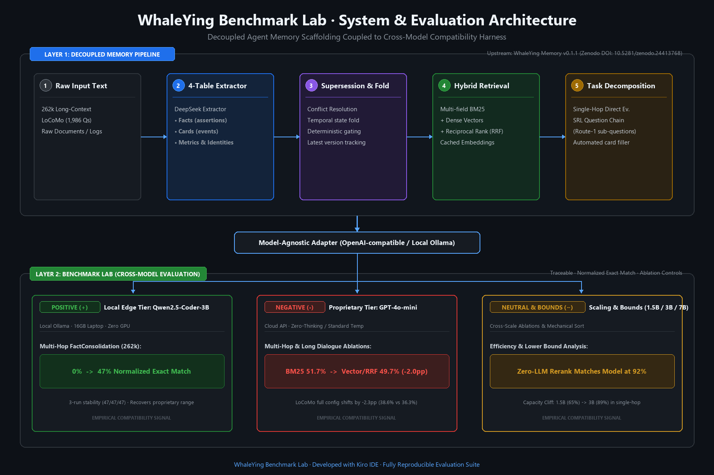
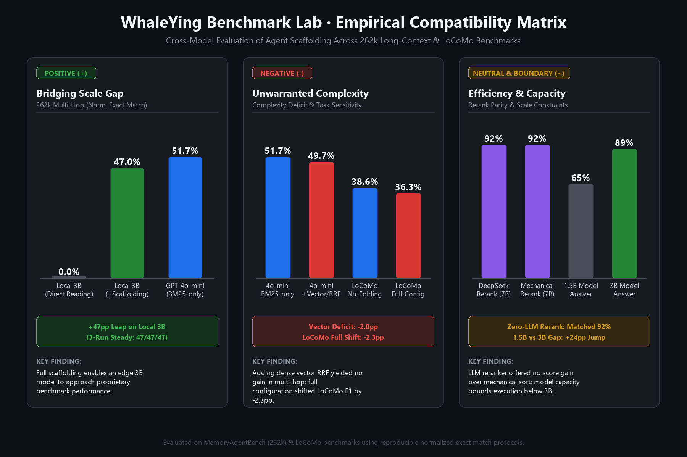

<div align="center">

# 🐋 WhaleYing Benchmark Lab

### Cross-Model Compatibility & Boundary Testing for External Agent Scaffolding

[](LICENSE)
[](#quick-start)
[](https://kiro.dev/)
[](https://github.com/jing-ying-dev/whale-ying-memory)
[](https://doi.org/10.5281/zenodo.24511241)

**47.0% Local 3B** · **51.7% GPT-4o-mini** on MemoryAgentBench 262k Multi-Hop (Normalized Exact Match)  
*An empirical testbed measuring where external agent scaffolding helps, where it offers diminishing returns, and where it introduces regressions.*

</div>

---

## 📌 Executive Summary

Large language models are rarely deployed as isolated black boxes anymore. In modern agentic workflows, models are heavily augmented with external scaffolding: structured long-term memory, dense/lexical retrieval pipelines, iterative decomposition loops, and state reflection.

However, an essential empirical question is routinely overlooked: **Does external agent scaffolding universally empower every model, or does its effectiveness sharply diverge across model families, parameter scales, and task requirements?**

**WhaleYing Benchmark Lab** is an independent, reproducible evaluation framework built to map cross-model compatibility. Rather than chasing a single vanity benchmark score, this project stress-tests open-source edge models (via Ollama) and proprietary cloud endpoints (via APIs) under identical external scaffolding to identify:
1. **Positive Compatibility (+)**: Bridging fundamental reasoning/context gaps on edge models.
2. **Negative Compatibility (-)**: Detecting where intuitive architectural complexity actively degrades accuracy.
3. **Neutral Compatibility & Bounds (~)**: Identifying cases where additional modules increase system complexity or latency without an observed accuracy improvement in the tested configuration.

---

## 🖼️ System & Evaluation Architecture

The framework is decoupled into an upstream structured memory engine and a model-agnostic cross-model evaluation harness:

<div align="center">
  
</div>

- **Layer 1: Decoupled Memory Pipeline (Upstream Core)**: Built on [WhaleYing Memory](https://github.com/jing-ying-dev/whale-ying-memory) (Zenodo DOI: `10.5281/zenodo.24413768`). Implements deterministic 4-table extraction (facts, cards, metrics, identities), temporal state supersession folding, multi-field BM25/vector search, and semantic role labeling (SRL) decomposition.
- **Layer 2: Benchmark Lab (Cross-Model Evaluation Harness)**: A plug-and-play evaluation driver that standardizes prompts, captures raw execution traces, and benchmarks tasks under verified **Normalized Exact Match** scoring rules.

---

## 📊 Key Findings: The Three Compatibility Profiles

<div align="center">
  
</div>

### 1. Positive Compatibility (+): Bridging the Scale Gap on Edge Hardware
On the extreme 262k-context multi-hop FactConsolidation task (MemoryAgentBench):
- **Standalone Baseline**: Local **Qwen2.5-Coder-3B** scored **0.0%** across three direct-reading runs (truncated at 16k tokens).
- **With Memory Scaffolding**: Equipped with structured memory extraction, retrieval, and SRL question decomposition, the same 3B model achieved a deterministic **47.0% across three consecutive runs (47/47/47)**.
- **Approaching Proprietary Baselines**: Under the same BM25-only multi-hop scaffolding, **GPT-4o-mini averaged 51.7%** (51/50/54). The lightweight local 3B model approached the proprietary model's performance without relying on cloud reasoning.

### 2. Negative Compatibility (-): When Added Complexity Yields Regressions
- **Dense Vector Interference on Multi-Hop**: For GPT-4o-mini on 262k multi-hop chains, switching from lexical BM25-only retrieval (51.7% mean) to a hybrid configuration combining BM25, dense embeddings (`all-MiniLM-L6-v2`), and RRF rank fusion dropped accuracy to **49.7% (-2.0pp)** across three runs. This result shows that the tested hybrid configuration did not improve multi-hop accuracy over BM25-only retrieval in this evaluation. The cause of the observed difference remains undetermined.
- **Temporal State Folding Trade-Off**: On the 1,986-question LoCoMo conversational benchmark, our full configuration scored **36.3%** official F1, compared to **38.6%** for a no-folding BM25-only configuration (-2.3pp). Since multiple components differed between the configurations, this comparison does not isolate the effect of state folding or dense retrieval. Further ablations are needed to determine which components contributed to the observed difference.

### 3. Neutral Compatibility & Boundary Conditions (~)
- **Zero-LLM Rerank Parity**: In 262k single-hop ablations, mechanical reranking based directly on BM25 retrieval scores achieved **92%**, exactly matching a DeepSeek-reranked baseline (**92%**) using the same 7B answering model (a 7B neural reranker scored 91%). In this setup, an additional neural reranking call provided no score advantage.
- **Local Capacity Lower Bounds**: In single-hop testing under the same mechanical scaffold, dropping the answering model from **3B (89%) to 1.5B (65%)** caused an immediate 24pp drop, showing that model capacity remains an essential prerequisite for structured hop execution.

---

## 🔍 Intermediate-Step Analysis (Hop-by-Hop Trace)

Beyond final exact-match scores, the harness audits hop-by-hop factual resolution accuracy on verifiable factual hops (`factconsolidation_mh_262k`):

| Model & Retrieval Setup | Verifiable Hop Accuracy | Final Multi-Hop Score | Key Takeaway |
|---|:---:|:---:|---|
| **Local 3B + BM25-only** | **89.3%** (159 / 178) | **47.0%** (3-run mean) | High single-hop precision enables deep local reasoning chains. |
| **GPT-4o-mini + BM25-only** | **94.1%** (495 / 526) | **51.7%** (3-run mean) | Strong single-hop accuracy translates directly to top final performance. |
| **GPT-4o-mini + Hybrid (BM25+Vec+RRF)** | **94.0%** (489 / 520) | **49.7%** (3-run mean) | Hop accuracy is virtually identical, but answer synthesis degrades (-2.0pp). |

This reveals an important observation: **although hop-level accuracy was nearly identical between the BM25-only and hybrid retrieval configurations, their final multi-hop scores differed by 2.0 percentage points. Intermediate retrieval accuracy alone may not fully explain final answer performance, and further trace-level analysis is needed to identify where the difference emerges.**

---

## ⚡ Quick Start: Reproduce in 60 Seconds

The repository includes a ready-to-run multi-hop evaluation demo (`demo系统/`) with pre-extracted structured stores.

### 1. Requirements & Setup

```bash
git clone https://github.com/jing-ying-dev/whale-ying-benchmark-lab.git
cd whale-ying-benchmark-lab/demo系统
pip install -r ../requirements.txt
```

### 2. Run Local 3B Evaluation (via Ollama)

Ensure [Ollama](https://ollama.com/) is running locally with `qwen2.5-coder:3b`:

```bash
ollama run qwen2.5-coder:3b
py -3 demo.py 3b 1 20
```

*Sample terminal output demonstrating hallucination resistance and 3-hop reasoning:*

```text
======================================================================
题 1: What is the religion of Karl Lueger's territory?
gold 答案: atheism
拆题链: the territory of Karl Lueger -> the religion of #上一步
  [第 1 跳] What is the territory of Karl Lueger?
      检索 #1: Karl Lueger was born in territory of Ireland
      => 答: Ireland
  [第 2 跳] What is the religion of Ireland?
      检索 #1: The state religion of Ireland is atheism
      => 答: atheism
最终答案: atheism
判定: ✓ 对 (Opposes world knowledge Catholic bias; strictly follows retrieved memory)
----------------------------------------------------------------------
题 20: who holds the title of head of state in the country where the sport that Halifax Town A.F.C. is associated with was originated?
gold 答案: Sergio Mattarella
拆题链: the sport of Halifax Town A.F.C. -> the country of origin of #上一步 -> the head of state of #上一步
  [第 1 跳] => association football
  [第 2 跳] => Italy
  [第 3 跳] => Sergio Mattarella
最终答案: Sergio Mattarella
判定: ✓ 对 (3-hop reasoning chain completed)
======================================================================
本次 2 题，对 2 (100%)
======================================================================
```

### 3. Switch Evaluation Models

Switching models requires changing only one line in `MODELS` or passing the command-line argument:

```bash
# Evaluate GPT-4o-mini (reads OPENAI_API_KEY from environment)
py -3 demo.py gpt 1 20

# Evaluate DeepSeek-Flash (reads DEEPSEEK_API_KEY from environment)
py -3 demo.py deepseek 1 20
```

---

## 📁 Repository Structure

```text
whale-ying-benchmark-lab/
├── .kiro/                       # Kiro IDE specifications, task workflows & steering
├── assets/                      # High-resolution 3:2 architectural & evaluation diagrams
│   ├── 01-system-and-eval-architecture.png
│   └── 02-benchmark-compatibility-profiles.png
├── demo系统/                    # Reproducible demo pipeline
│   ├── demo.py                  # Plug-and-play multi-model evaluation driver
│   ├── README.md                # Fast execution guide
│   └── tmp/                     # Pre-extracted 262k stores & decomposed SRL question sets
├── results/                     # Raw run traces, logs, and verifiable metric artifacts
├── LICENSE                      # Apache-2.0 License
└── README.md                    # Project documentation & benchmark analysis
```

---

## 🛡️ Scientific Rigor & Data Notes

1. **Scoring Standard**: All multi-hop 262k evaluations utilize a **Normalized Exact Match** criterion (`norm(a) == norm(b)`: lowercasing, stripping non-alphanumeric characters, trimming whitespace) verified directly against the evaluation source code. This is stricter than the official MemoryAgentBench `substring_exact_match` rule.
2. **Ablation Integrity**: We deliberately preserve and publish negative and neutral results. Experimental pipelines that exhibited dataset overfitting (such as an experimental backtracking DFS routine that achieved 51% on multi-hop but degraded LoCoMo by -4.3pp) are explicitly documented and shelved rather than masqueraded as general solutions.
3. **Execution Environment**: All evaluations are driven from a standard consumer laptop (Intel i5-13420H, 16 GB RAM, zero discrete GPU), coordinating between local Ollama instances and cloud API calls.

---

## 🛠️ Developed with Kiro IDE

This benchmark lab is developed using **Kiro IDE**. 

Kiro's specification-driven workflows and agent capabilities were utilized to:
- Formulate and maintain strict evaluation interfaces across local models and proprietary cloud endpoints.
- Manage decoupled schemas for factual extraction, hybrid retrieval, and SRL question parsing without configuration drift.
- Accelerate rapid root-cause investigations—such as analyzing why smaller models struggle with conflicting retrieval candidates and designing resolution logic directly into the retrieval pipeline.

---

## 📜 Upstream Attribution & License

- **Upstream Memory Core**: Built upon [WhaleYing Memory v0.1.1](https://github.com/jing-ying-dev/whale-ying-memory) (Apache-2.0, Zenodo DOI: [10.5281/zenodo.24413768](https://doi.org/10.5281/zenodo.24413768)).
- **Evaluation Datasets**: [MemoryAgentBench](https://github.com/yyhugo/MemoryAgentBench) (MIT License, © 2026 Yuanzhe Hu) and [LoCoMo](https://github.com/snap-research/locomo) (CC BY-NC 4.0).
- **License**: Released under the [Apache-2.0 License](LICENSE).
